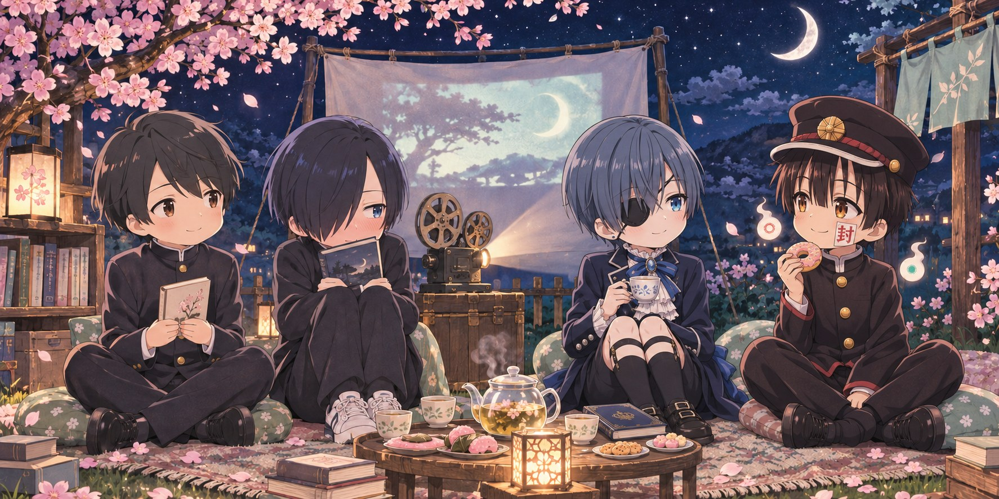

  

<h3 align="center">✦ 今夜も、好きなものをつくろう。</h3>

  今晚，也做一点自己喜欢的东西。 
  Welcome to my little corner of the internet.

<table>
<tr>
<td width="70%" valign="middle">
  <h3>🌸 こんばんは、Tokyo です。</h3>
  
欢迎来到我的月下工房。

  
喜欢二次元、薄荷青，以及那些 「要是能做出来就好了」的小小幻想。

  
正在学习 AI、编程和电子。 想把喜欢的画面变成交互，把生活里的麻烦变成小工具。

  
设定是白发神官，日常是和 bug 对线。 还在练级，但好奇心已经点满了。

</td>
<td width="30%" align="center" valign="middle">
   
  工房主人 · Tokyo
</td>
</tr>
</table>

### 🗝️ 尚未通关的支线

- **让代码学会一点魔法**　研究 AI 与 Agent，试着把想法变成能工作的伙伴。
- **给日常装上快捷键**　写自动化工具，连接设备，解决自己的小麻烦。
- **把喜欢的世界做出来**　探索动漫风界面、交互与各种奇怪但有趣的实验。

  <b>🌙 这里是故事的序章。</b> 
  作品慢慢做，世界慢慢探索。  
  またね。次のセーブポイントで。 
  下一个存档点见。

<!-- moonlit-anime-club:start -->

<h2 align="center">🎞️ 月下放映室 · 月あかりのシネマ</h2>

  <b>把喜欢的人物，留在同一片星空下。</b> 
  青春的心跳 · 少年的秘密 · 月夜的怪谈 · 耳机里的世界

  
   今夜の同席者 / 小太郎 · 京太郎 · 夏尔 · 花子君

  <a href="#residents">常驻席位</a> ·
  <a href="#free-special">岩鸢游泳部</a> ·
  <a href="#quotes">台词留声机</a> ·
  <a href="#music">月下点唱机</a> ·
  <a href="#screenings">放映目录</a>

### 🪑 常驻席位 · 小さな住人たち

<table>
<tr>
<td width="50%" valign="top">
<h3>🌙 安昙小太郎</h3>

<b>安曇 小太郎 · 月色真美</b> 月がきれい / Tsuki ga Kirei

文学少年，把心事藏在书页和迟迟没有发出的消息里。安静的日常，也能装下很认真的喜欢。

<b>座位：</b>窗边，有月光的那一席。 <b>随身物：</b>文库本、笔记本、一点点勇气。

</td>
<td width="50%" valign="top">
<h3>📚 市川京太郎</h3>

<b>市川 京太郎 · 我心里危险的东西</b> 僕の心のヤバイやつ / The Dangers in My Heart

刘海后面藏着热闹的内心剧场。嘴上别扭，心里却一点点学会关心别人，也学会承认自己的心意。

<b>座位：</b>图书室最熟悉的角落。 <b>随身物：</b>书、耳机、正在解除的心防。

</td>
</tr>
<tr>
<td width="50%" valign="top">
<h3>🫖 夏尔·凡多姆海威</h3>

<b>シエル・ファントムハイヴ · 黑执事</b> 黒執事 / Black Butler

蓝灰色的发、眼罩、层层叠叠的领结。小小的贵族少年，漂亮又骄傲；精致的茶杯后面，还藏着不愿轻易示人的心事。

<b>座位：</b>茶具最齐全的丝绒靠垫。 <b>随身物：</b>红茶、棋子，以及留给甜点的位置。

</td>
<td width="50%" valign="top">
<h3>🍩 花子君</h3>

<b>花子くん · 地缚少年花子君</b> 地縛少年花子くん / Toilet-bound Hanako-kun

旧式帽子、琥珀色的眼睛、脸颊上的小小封印。笑起来有点狡黠，靠近时又让人心软；可爱的怪谈少年，也有自己的秘密。

<b>座位：</b>灯笼旁，白杖代也能飘着看。 <b>随身物：</b>甜甜圈、一点恶作剧、没有说完的故事。

</td>
</tr>
</table>

席位与随身物是这个小站的同人设定；角色介绍与下方短评为原创。

### 🏊 特别放映 · 《Free!》第一季

岩鳶高校水泳部 · 2013 · 第一季官方角色图

<table>
<tr>
<td width="50%" align="center" valign="top">
  
  <h4>🐧 叶月渚 · 葉月 渚</h4>
  
岩鸢高中一年级 · 蛙泳 · CV 代永翼

  
金发、红眼睛，笑起来像夏天。因为一直想再和遥一起游泳，他考进了遥所在的高中。

</td>
<td width="50%" align="center" valign="top">
  
  <h4>🌊 七濑遥 · 七瀬 遙</h4>
  
岩鸢高中二年级 · 自由泳 · CV 岛崎信长

  
黑发、蓝眼睛，平时话很少。碰到水时那份认真的样子，最容易让人记住他。

</td>
</tr>
</table>

角色图来自 <a href="https://1st.iwatobi-sc.com/sp/character/">《Free!》第一季官网</a> · <a href="https://www.youtube.com/watch?v=JNU1ehnCVP8">观看京都动画官方 PV</a> · <a href="#music">去点唱机听第一季音乐</a>

### 📻 台词留声机 · ことばの余韻

> **「僕は…山田が好きなんだ」**  
> 我……喜欢山田。  
> —— 市川京太郎 ·《我心里危险的东西》

**放映室手记：** 有时，成长不是突然变得厉害，而是终于愿意诚实地叫出一种感情的名字。

> **「ただの人間には興味ありません。」**  
> 我对普通的人类没有兴趣。  
> —— 凉宫春日 ·《凉宫春日的忧郁》

**放映室手记：** 把这份中二留一点给创造力：日常没有自动长出奇迹，那就试着做出一个有趣的小东西。

> **「何かを得るためには、それと同等の代価が必要になる」**  
> 想得到什么，就需要付出同等的代价。  
> ——《钢之炼金术师》（2003 年版）片头旁白节选

**放映室手记：** 学习需要时间，选择也有代价；但人与人的善意，并不总是一张必须结清的账单。

🔎 台词出处与阅读说明

日文为短句摘录，中文为本站译意；「放映室手记」是原创感想，不是角色原话。涉及少量人物心意，未展开关键剧情。

- **我心里危险的东西**：[MOVIE WALKER PRESS 名场面回顾](https://press.moviewalker.jp/news/article/1317151/)
- **凉宫春日的忧郁**：[涼宮ハルヒシリーズ大辞典 · 台词资料](https://w.atwiki.jp/haruhi_dictionary/pages/88.html)
- **钢之炼金术师**：[日文旁白摘录](https://aipophia.jp/wisdom/q/work-manga-hagaren-exchange/)

### 🎧 月下点唱机 · 夜に溶けるプレイリスト

  

  <b>把灯调暗一点，把耳机戴好。</b> 
  有些故事已经散场，旋律却替我们多停留了一会儿。

**01 · One Last Kiss — 宇多田光**  
《新·福音战士剧场版》主题曲 · [▶ 官方 MV](https://www.youtube.com/watch?v=0Uhh62MUEic)  
轻盈的电子节拍里藏着告别的重量。像晚风吹过车窗，风景已经向后退去，心里却还留着某个人的轮廓。  
留给：不想立刻结束的夜晚。

<table>
<tr>
<td width="50%" valign="top">
<h4>02 · 斜陽 / 斜阳</h4>

<b>ヨルシカ / Yorushika</b> 《我心里危险的东西》第一季 OP

吉他像傍晚的光，明亮里带一点酸涩。很适合小太郎和京太郎身边那些还没说出口的心事。

<a href="https://www.youtube.com/watch?v=Za2FmwuIEwY">▶ 官方无字幕 OP</a>

</td>
<td width="50%" valign="top">
<h4>03 · イマココ / 此时此地</h4>

<b>东山奈央</b> 《月色真美》OP

清透、轻快，像放学后绕远一点的回家路。还不太会表达喜欢，却已经开始期待明天。

<a href="https://www.youtube.com/watch?v=ZGHRRdMWSIw">▶ 官方 MV</a>

</td>
</tr>
<tr>
<td width="50%" valign="top">
<h4>04 · 月がきれい / 月色真美</h4>

<b>东山奈央</b> 《月色真美》ED

把热闹慢慢放轻的一首歌。适合夜里看完一集之后，留着片尾，暂时什么也不做。

<a href="https://www.youtube.com/watch?v=Yeyo54qc4Cg">▶ 官方音源</a>

</td>
<td width="50%" valign="top">
<h4>05 · Anytime Anywhere</h4>

<b>milet</b> 《葬送的芙莉莲》第一季 ED

温柔的开头，慢慢铺开的辽阔感。像很久以后回望一段旅程，才发现那些日常一直在心里发光。

<a href="https://www.youtube.com/watch?v=r105CzDvoo0">▶ 官方 MV</a>

</td>
</tr>
<tr>
<td width="50%" valign="top">
<h4>06 · more than words</h4>

<b>羊文学</b> 《咒术回战》第二季「涩谷事变」ED

朦胧的人声和吉他，像城市夜色里的独白。疲惫、犹豫与一点点倔强，都能留在这首歌里。

<a href="https://www.youtube.com/watch?v=kGY6N9DL4Jw">▶ 官方 MV</a>

</td>
<td width="50%" valign="top">
<h4>07 · かたわれ時 / 黄昏之时</h4>

<b>RADWIMPS</b> 《你的名字。》原声配乐 · BGM

没有人声，让钢琴替画面呼吸。适合看书、写一点代码，或者单纯望着窗外发呆。

<a href="https://www.youtube.com/watch?v=mhpRipG9Zss">▶ 官方音源</a>

</td>
</tr>
</table>

#### 💿 夏夜加映 · 岩鸢游泳部精选

- **08 · Rage on — OLDCODEX** · 第一季 OP  
  吉他一响就有站上出发台的紧张感。[Lantis 官方 MV](https://www.youtube.com/watch?v=P8JV2xnyJ9Q)
- **09 · SPLASH FREE — STYLE FIVE** · 第一季 ED  
  五位主角声优一起唱，节拍俏皮，适合给训练后的夏夜加点热闹。[动画官网试听](https://1st.iwatobi-sc.com/sp/product/cd/ed/)
- **10 · A boy in the water — 加藤达也** · 第一季 BGM  
  想让耳机里只剩配乐时，听这首。它是原声专辑第一碟的第 2 轨。[Apple Music 原声专辑](https://music.apple.com/gd/album/tv%E3%82%A2%E3%83%8B%E3%83%A1-free-%E3%82%AA%E3%83%AA%E3%82%B8%E3%83%8A%E3%83%AB%E3%82%B5%E3%82%A6%E3%83%B3%E3%83%89%E3%83%88%E3%83%A9%E3%83%83%E3%82%AF-ever-blue-sounds/1584268225)
- **11 · EVER BLUE — STYLE FIVE** · 第一季特别 ED  
  更适合留到最后一首。听着会想起接力的那一刻，和几个朋友游过同一片水。[Apple Music 原声专辑 · 第二碟第 26 轨](https://music.apple.com/gd/album/tv%E3%82%A2%E3%83%8B%E3%83%A1-free-%E3%82%AA%E3%83%AA%E3%82%B8%E3%83%8A%E3%83%AB%E3%82%B5%E3%82%A6%E3%83%B3%E3%83%89%E3%83%88%E3%83%A9%E3%83%83%E3%82%AF-ever-blue-sounds/1584268225)

点击各曲目旁的链接收听 · 听感文字为原创

### 🎟️ 今夜想进入哪个世界？

🌸 青春馆 · 连一句「喜欢」都要练习很久

**《月色真美》** — 把镜头交给普通的放学路、手机消息和不太熟练的初恋。  
**《我心里危险的东西》** — 在内心戏和笨拙相处之间，看一个人慢慢走出自我否定。

*这一馆留给：那些小到不值一提，却会在心里停留很久的瞬间。*

🕯️ 秘密馆 · 红茶、甜甜圈与少年的另一面

**《黑执事》** — 华丽礼服、英伦宅邸与契约；小小的少年伯爵，背负着沉重的秘密。  
**《地缚少年花子君》** — 从校园七大不可思议走进怪异世界，可爱的外表与幽暗的故事相互映照。

*夏尔的红茶请先放好。花子君，你不能把所有甜甜圈都拿走。*

🌌 深夜馆 · 自我、代价与不普通的日常

**《新世纪福音战士》** — 巨大机体背后，是人对认可的渴望与靠近彼此的困难。  
**《钢之炼金术师》** — 从等价交换出发，追问失去、责任与人能够守住的底线。  
**《凉宫春日的忧郁》** — 当一个不愿接受无聊日常的人，遇上了真正不普通的世界。

*可以带着问题离场，不必在片尾之前想明白人生。*

  <b>🌙 散场以后，喜欢的世界还在。</b> 
  这里有写到一半的代码，也有舍不得按下停止的片尾曲。  
  また、好きな世界で会おう。 
  下次，在喜欢的世界里再见。  
  非官方同人角落 · 四人合影为 Q 版同人图 · 《Free!》角色图来自第一季官网

<!-- moonlit-anime-club:end -->
