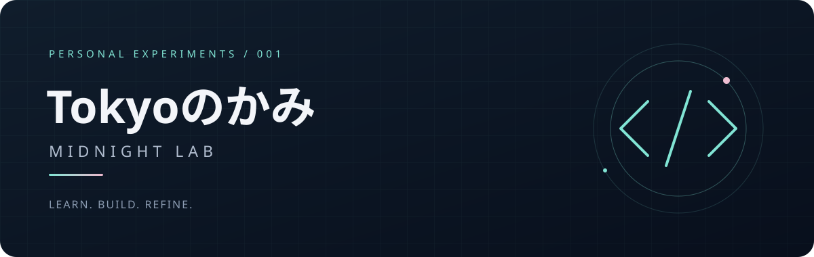

  

  <b>把好奇心，写成可以运行的东西。</b> 
  Turning small curiosities into things that work.

---

### こんにちは、Tokyo です。

这里是我的个人实验室。喜欢 AI、代码、电子，以及那些看起来有点奇怪、做出来却很有意思的想法。

正在从基础开始，一边学习，一边把生活里的小问题变成小作品。

### 正在探索 · Exploring

| 方向 | 想做的事 |
| :--- | :--- |
| **AI & Agents** | 理解模型，让 AI 参与真正有用的工作 |
| **Code & Automation** | 写小工具，把重复的事情交给程序 |
| **Hardware & Networks** | 连接设备，看看软硬件一起能做什么 |
| **Creative Experiments** | 尝试交互、视觉和不太常规的项目 |

### 实验室手记 · Lab notes

- **Learn** — 先弄懂一个具体问题。
- **Build** — 做出一个能运行的小版本。
- **Refine** — 用起来，再慢慢打磨。

作品会随着学习逐步放上来。这个空间刚刚开始。

  好奇心常亮。 · Stay curious, keep building.

  

