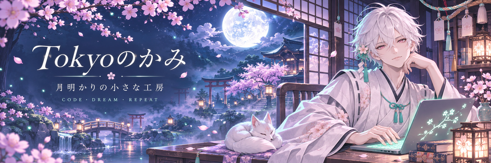

  

<h3 align="center">✦ 今夜も、好きなものをつくろう。</h3>

  今晚，也做一点自己喜欢的东西。 
  Welcome to my little corner of the internet.

<table>
<tr>
<td width="70%" valign="middle">
  <h3>🌸 こんばんは、Tokyo です。</h3>
  
欢迎来到我的月下工房。

  
喜欢二次元、薄荷青，以及那些 「要是能做出来就好了」的小小幻想。

  
正在学习 AI、编程和电子。 想把喜欢的画面变成交互，把生活里的麻烦变成小工具。

  
设定是白发神官，日常是和 bug 对线。 还在练级，但好奇心已经点满了。

</td>
<td width="30%" align="center" valign="middle">
   
  工房主人 · Tokyo
</td>
</tr>
</table>

### 🗝️ 尚未通关的支线

- **让代码学会一点魔法**　研究 AI 与 Agent，试着把想法变成能工作的伙伴。
- **给日常装上快捷键**　写自动化工具，连接设备，解决自己的小麻烦。
- **把喜欢的世界做出来**　探索动漫风界面、交互与各种奇怪但有趣的实验。

  <b>🌙 这里是故事的序章。</b> 
  作品慢慢做，世界慢慢探索。  
  またね。次のセーブポイントで。 
  下一个存档点见。

