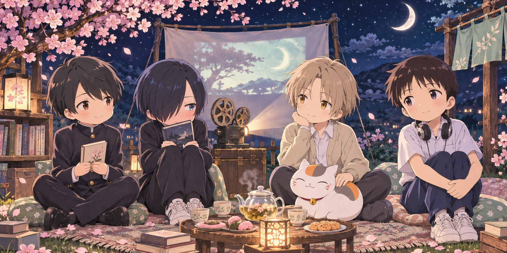

  

<h3 align="center">✦ 今夜も、好きなものをつくろう。</h3>

  今晚，也做一点自己喜欢的东西。 
  Welcome to my little corner of the internet.

<table>
<tr>
<td width="70%" valign="middle">
  <h3>🌸 こんばんは、Tokyo です。</h3>
  
欢迎来到我的月下工房。

  
喜欢二次元、薄荷青，以及那些 「要是能做出来就好了」的小小幻想。

  
正在学习 AI、编程和电子。 想把喜欢的画面变成交互，把生活里的麻烦变成小工具。

  
设定是白发神官，日常是和 bug 对线。 还在练级，但好奇心已经点满了。

</td>
<td width="30%" align="center" valign="middle">
   
  工房主人 · Tokyo
</td>
</tr>
</table>

### 🗝️ 尚未通关的支线

- **让代码学会一点魔法**　研究 AI 与 Agent，试着把想法变成能工作的伙伴。
- **给日常装上快捷键**　写自动化工具，连接设备，解决自己的小麻烦。
- **把喜欢的世界做出来**　探索动漫风界面、交互与各种奇怪但有趣的实验。

  <b>🌙 这里是故事的序章。</b> 
  作品慢慢做，世界慢慢探索。  
  またね。次のセーブポイントで。 
  下一个存档点见。

<!-- moonlit-anime-club:start -->

<h2 align="center">🎞️ 月下放映室 · 月あかりのシネマ</h2>

  <b>把喜欢的人物，留在同一片星空下。</b> 
  青春的心跳 · 温柔的异闻 · 笨拙的勇气 · 偶尔拯救世界

  
   今夜の同席者 / 小太郎 · 京太郎 · 夏目 &amp; 猫咪老师 · 真嗣

  <a href="#residents">常驻席位</a> ·
  <a href="#quotes">台词留声机</a> ·
  <a href="#screenings">放映目录</a>

### 🪑 常驻席位 · 小さな住人たち

<table>
<tr>
<td width="50%" valign="top">
<h3>🌙 安昙小太郎</h3>

<b>安曇 小太郎 · 月色真美</b> 月がきれい / Tsuki ga Kirei

文学少年，把心事藏在书页和迟迟没有发出的消息里。安静的日常，也能装下很认真的喜欢。

<b>座位：</b>窗边，有月光的那一席。 <b>随身物：</b>文库本、笔记本、一点点勇气。

</td>
<td width="50%" valign="top">
<h3>📚 市川京太郎</h3>

<b>市川 京太郎 · 我心里危险的东西</b> 僕の心のヤバイやつ / The Dangers in My Heart

刘海后面藏着热闹的内心剧场。嘴上别扭，心里却一点点学会关心别人，也学会承认自己的心意。

<b>座位：</b>图书室最熟悉的角落。 <b>随身物：</b>书、耳机、正在解除的心防。

</td>
</tr>
<tr>
<td width="50%" valign="top">
<h3>🍃 夏目贵志 &amp; 猫咪老师</h3>

<b>夏目 貴志 · 夏目友人帐</b> 夏目友人帳 / Natsume's Book of Friends

看得见别人看不见的世界，也愿意听见那些被遗忘的名字。温柔有时是告别，有时是终于有了回家的地方。

<b>座位：</b>能吹到晚风的缘侧。 <b>随身物：</b>友人帐，以及一位很会吃的保镖。

</td>
<td width="50%" valign="top">
<h3>🎧 碇真嗣</h3>

<b>碇 シンジ · 新世纪福音战士</b> 新世紀エヴァンゲリオン / Evangelion

耳机里的世界很小，落在肩上的期待很大。比起驾驶巨大的机器，理解自己、靠近别人，有时更加困难。

<b>座位：</b>留一点距离，也留一个位置。 <b>随身物：</b>耳机、随身听、尚未整理好的心情。

</td>
</tr>
</table>

席位与随身物是这个小站的同人设定；角色介绍与下方短评为原创。

### 📻 台词留声机 · ことばの余韻

> **「僕は…山田が好きなんだ」**  
> 我……喜欢山田。  
> —— 市川京太郎 ·《我心里危险的东西》

**放映室手记：** 有时，成长不是突然变得厉害，而是终于愿意诚实地叫出一种感情的名字。

> **「逃げちゃダメだ」**  
> 不能逃避。  
> —— 碇真嗣 ·《新世纪福音战士》

**放映室手记：** 这句自我催促里也有恐惧与压力。它让人想问：勇气究竟是咬牙留下，还是能够理解自己的选择？休息和求助，也可以是向前的一部分。

> **「ただの人間には興味ありません。」**  
> 我对普通的人类没有兴趣。  
> —— 凉宫春日 ·《凉宫春日的忧郁》

**放映室手记：** 把这份中二留一点给创造力：日常没有自动长出奇迹，那就试着做出一个有趣的小东西。

> **「何かを得るためには、それと同等の代価が必要になる」**  
> 想得到什么，就需要付出同等的代价。  
> ——《钢之炼金术师》（2003 年版）片头旁白节选

**放映室手记：** 学习需要时间，选择也有代价；但人与人的善意，并不总是一张必须结清的账单。

🔎 台词出处与阅读说明

日文为短句摘录，中文为本站译意；「放映室手记」是原创感想，不是角色原话。涉及少量人物心意，未展开关键剧情。

- **我心里危险的东西**：[MOVIE WALKER PRESS 名场面回顾](https://press.moviewalker.jp/news/article/1317151/)
- **新世纪福音战士**：[J-CAST 对碇真嗣台词的介绍](https://www.j-cast.com/trend/2019/04/01354118.html)
- **凉宫春日的忧郁**：[涼宮ハルヒシリーズ大辞典 · 台词资料](https://w.atwiki.jp/haruhi_dictionary/pages/88.html)
- **钢之炼金术师**：[日文旁白摘录](https://aipophia.jp/wisdom/q/work-manga-hagaren-exchange/)

### 🎟️ 今夜想进入哪个世界？

🌸 青春馆 · 连一句「喜欢」都要练习很久

**《月色真美》** — 把镜头交给普通的放学路、手机消息和不太熟练的初恋。  
**《我心里危险的东西》** — 在内心戏和笨拙相处之间，看一个人慢慢走出自我否定。

*这一馆留给：那些小到不值一提，却会在心里停留很久的瞬间。*

🍵 温柔馆 · 给无处安放的心情留一个座位

**《夏目友人帐》** — 名字、约定、相遇与告别；一个人与妖怪共同生活的温柔世界。

*猫咪老师占了两个座位。请用点心协商，不要硬挤。*

🌌 深夜馆 · 自我、代价与不普通的日常

**《新世纪福音战士》** — 巨大机体背后，是人对认可的渴望与靠近彼此的困难。  
**《钢之炼金术师》** — 从等价交换出发，追问失去、责任与人能够守住的底线。  
**《凉宫春日的忧郁》** — 当一个不愿接受无聊日常的人，遇上了真正不普通的世界。

*可以带着问题离场，不必在片尾之前想明白人生。*

  <b>🌙 散场以后，喜欢的世界还在。</b> 
  这里有写到一半的代码，也有舍不得按下停止的片尾曲。  
  また、好きな世界で会おう。 
  下次，在喜欢的世界里再见。  
  非官方同人角落 · 插图为 AI 生成的 Q 版同人演绎

<!-- moonlit-anime-club:end -->
